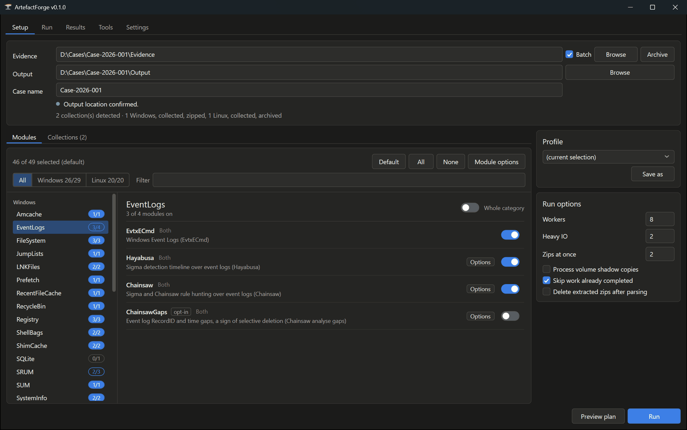
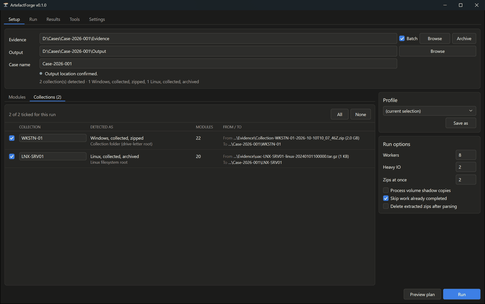
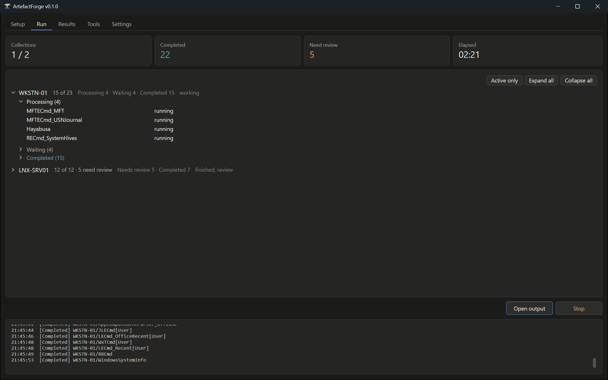
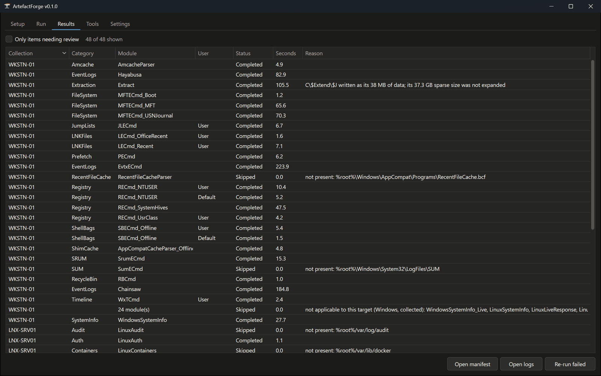

# ArtefactForge

> [!WARNING]
> **Beta.** ArtefactForge is in its 0.x beta: it works, but expect rough edges, and things may
> change between releases. Use it at your own risk, check its output before you rely on it in a
> case, and report anything odd in [Issues](../../issues).

A forensic artefact processing tool. Point it at collected evidence, pick modules, get parsed
CSV - with the collection layout detected, the tools run in parallel, and every invocation
recorded.

Windows and Linux evidence, from a WPF interface or a command line over the same engine. It
processes; it does not collect. Bring a collection from the triage tool you already use.

Each parser is driven by a module file, so adding a tool is a file drop rather than code.

## Why this exists

ArtefactForge started as a side project. I can find my way around code, but mostly I wanted to
put Claude through its paces on something I'd actually use. That something was a tool that takes
a pile of triage collections and processes them all in one go, so I could stop babysitting each
one. It held up better than I expected. Bug reports are welcome, and so is applause for the robot.

---

## What it does

- **Detects the layout.** CyLR, KAPE `tout`, a mounted drive, a live system and a Linux export all
  put the root somewhere different. Modules reference a canonical `%root%` and the engine resolves
  it, then selects the modules that apply to that platform.
- **Runs in parallel** across modules and collections from one worker pool, with disk-bound
  modules throttled separately.
- **Skips with a reason**, never in silence: `not present: %root%\$Boot`.
- **Iterates per user profile**, with the username in the output filename.
- **Records what ran**: exact command line, tool version and SHA-256, exit code, and output file
  count and size, per invocation.
- **Batch processes** a folder of collections and resumes where it stopped.
- **Processes Linux evidence on Windows**, as a folder (UAC output, a tar, or an X-Ways or FTK
  export), so no ext4 driver is needed. Where no Windows tool exists, such as the systemd journal,
  ArtefactForge carries its own parser.

## Screenshots


*Setup: point it at the evidence, pick the modules by category, and set the worker counts.*


*Collections: each collection's layout is detected, with the modules that apply to it.*


*Run: a Windows and a Linux collection processed in one batch, with live status per module.*


*Results: every module's status and run time, and the reason for anything skipped.*

## Quick start

1. Download the latest zip from [Releases](../../releases) and extract it anywhere. It needs the
   .NET 9 Desktop Runtime, which the EZ Tools already require.
2. Third-party tools are not bundled. Put the EZ Tools in `Tools\eztools\` (and Hayabusa and
   Chainsaw in `Tools\hayabusa\` and `Tools\chainsaw\` if you want them), or point `--tools` at an
   existing install. `ArtefactForgeCli tools` shows what was found.
3. Run `ArtefactForge.exe`, or from the command line:

```
ArtefactForgeCli plan "D:\Collections\HOST01"
ArtefactForgeCli run  "D:\Collections\HOST01" "D:\Cases" --case HOST01
ArtefactForgeCli run  "D:\Collections" "D:\Cases" --batch --profile EventLogs-triage --workers 6
```

The full manual - GUI tabs, every command, output layout, statuses, resume - is on
[cheng4n6.com](https://cheng4n6.com/).

---

## Why you can trust the output

**Checked row for row.** Its output was compared row for row against an established EZ Tools
processing script on the same evidence: 2,253,650 rows across 12 categories, an exact match, in
132 s against the script's 224 s. The comparison is scripted and
re-run when a module's command line changes.

**Exit codes are not trusted.** RECmd returns 0 on bad arguments while writing nothing. So a
module that exits 0 and writes nothing is `NoOutput`, one that writes unexpected stderr is
`CheckLog`, and both are counted as needing review rather than passing as complete.

**Its own parsers are checked against the reference tool.** The journal parser is compared field
for field with `journalctl` output. 

**Updates are signed.** The app never checks for updates on its own. When you ask, it installs
only a release whose manifest is signed by a key compiled into the build, whose zip matches the
SHA-256 that manifest states, and which is newer than what is running. Your edited modules,
profiles and `Apps.yaml` are kept, and a failed update rolls back.

## Reading the output

[cheng4n6.com](https://cheng4n6.com/artefacts/) is a reference library of forensic artefact
cards. Many carry a *Reading the output* section written against the same parsers' CSV: which
columns to sort and filter on, what to look for, and what not to trust.

## Building

To use ArtefactForge, download a [release](https://github.com/cheng4n6/ArtefactForge/releases);
there is no need to build it. To build it yourself you need:

- Windows (the interface is WPF).
- The .NET 9 SDK, 9.0.317 or a later 9.0 SDK (`global.json` pins it). `dotnet --list-sdks` shows
  what is installed.
- Internet access to nuget.org the first time you build, to download the packages it uses. The
  repository's `nuget.config` names nuget.org, so the machine's own NuGet settings do not need to.

```
winget install Microsoft.DotNet.SDK.9
dotnet build
dotnet test
.\package.ps1 -NoTools -Archive
```

If restore fails with `NU1100: Unable to resolve ...`, the packages could not be downloaded:
check that the machine can reach `https://api.nuget.org` (a proxy or firewall may block it) and
that `dotnet nuget list source` shows nuget.org as Enabled.

## Licence

MIT - see [LICENSE](LICENSE). Third-party tools are not redistributed and keep their own licences.
